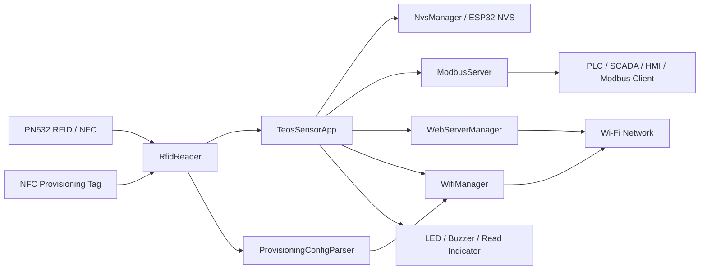

# TeosSensor — RFID / Modbus TCP Üretim Takip Sistemi

ESP32-S3 tabanlı, **RFID/NFC kart okuma + Wi-Fi + Web yönetim paneli + Modbus TCP** bileşenlerini tek bir edge cihaz üzerinde birleştiren gömülü sistem firmware'i.

Sistem; RFID kartlarının UID bilgisini okuyup yerel ağ üzerinden **Modbus TCP Holding Register**'larına taşımayı, cihaz ağ ayarlarını Web arayüzü veya **NFC provisioning tag** üzerinden yapılandırmayı ve yapılandırmayı ESP32'nin kalıcı **NVS** belleğinde saklamayı hedefler.

> **Proje yaklaşımı:** Donanım erişimi, ağ yönetimi, RFID okuma, kalıcı depolama, Modbus ve Web arayüzü ayrı sınıflar/katmanlar halinde tutulur. `main.cpp` yalnızca uygulama orkestrasyonuna giriş noktasıdır.

---

## İçindekiler

- [Öne Çıkan Özellikler](#öne-çıkan-özellikler)
- [Sistem Mimarisi](#sistem-mimarisi)
- [Çalışma Mantığı](#çalışma-mantığı)
- [Donanım](#donanım)
- [GPIO ve Donanım Haritası](#gpio-ve-donanım-haritası)
- [Modbus TCP](#modbus-tcp)
- [Wi-Fi ve Ağ Yapılandırması](#wi-fi-ve-ağ-yapılandırması)
- [NFC Provisioning](#nfc-provisioning)
- [Web Yönetim Paneli](#web-yönetim-paneli)
- [NVS Kalıcı Depolama](#nvs-kalıcı-depolama)
- [RFID Okuma Davranışı](#rfid-okuma-davranışı)
- [LED, Buzzer ve Durum Göstergeleri](#led-buzzer-ve-durum-göstergeleri)
- [Yazılım Mimarisi](#yazılım-mimarisi)
- [Proje Yapısı](#proje-yapısı)
- [Kullanılan Teknolojiler ve Kütüphaneler](#kullanılan-teknolojiler-ve-kütüphaneler)
- [Kurulum](#kurulum)
- [İlk Çalıştırma](#ilk-çalıştırma)
- [Modbus İstemcisi ile Test](#modbus-i̇stemcisi-ile-test)
- [Seri Port Logları](#seri-port-logları)
- [Hata Ayıklama](#hata-ayıklama)
- [Güvenlik Notları](#güvenlik-notları)
- [Bilinen Sınırlamalar ve Teknik Notlar](#bilinen-sınırlamalar-ve-teknik-notlar)
- [Geliştirme Yol Haritası](#geliştirme-yol-haritası)
- [Lisans](#lisans)

---

## Öne Çıkan Özellikler

### RFID / NFC

- **Adafruit PN532** ile ISO14443A tabanlı kart/tag tarama
- Normal çalışma modunda RFID kart UID okuma
- AP provisioning modunda NFC/NDEF içeriğinden ağ yapılandırması okuma
- NTAG2xx sayfalarından veri okuma
- NDEF Text Record desteği
- `text/plain` MIME tabanlı kayıt desteği
- Düz metin fallback parser'ı
- 4-byte UID'leri doğrudan `uint32_t` değerine dönüştürme
- 4-byte dışındaki UID uzunlukları için FNV-1a tabanlı 32-bit özetleme

### Ağ

- Wi-Fi **STA (Station)** modu
- Yapılandırma gerektiğinde **AP (Access Point)** provisioning modu
- Statik IPv4 yapılandırması
- Otomatik yeniden bağlanma
- Wi-Fi bilgilerinin ve statik ağ ayarlarının NVS'de kalıcı saklanması
- NFC tag üzerinden ağ yapılandırması
- Web panelinden ağ yapılandırması

### Endüstriyel Haberleşme

- **Modbus TCP Server**
- TCP portu: **502**
- Kart UID bilgisinin iki adet 16-bit Holding Register'a bölünerek taşınması
- Anlık UID ile son okunan UID'nin ayrı tutulması
- PLC / SCADA / HMI / başka bir Modbus TCP istemcisinin veriye erişebilmesi

### Cihaz Yönetimi

- Embedded Web yönetim paneli
- Wi-Fi / IP / Gateway / Subnet ayarları
- Web üzerinden restart
- Web üzerinden factory reset
- ESP32-S3 üzerindeki **BOOT / GPIO0** düğmesiyle fiziksel factory reset
- Kalıcı son UID saklama
- Kart okuma için buzzer + dijital çıkış göstergesi
- AP / STA bağlantı durumunu LED'lerle gösterme

---

## Sistem Mimarisi



### Katmanlar

| Katman | Sorumluluk |
|---|---|
| `main.cpp` | Arduino `setup()` / `loop()` giriş noktası |
| `TeosSensorApp` | Uygulama orkestrasyonu ve görev sırası |
| `RfidReader` | PN532 başlatma, kart tarama, UID ve NFC veri çıkarma |
| `WifiManager` | STA/AP yönetimi, statik IP ve yeniden bağlanma |
| `WebServerManager` | Web arayüzü ve HTTP endpoint'leri |
| `ModbusServer` | Modbus TCP sunucusu ve Holding Register yönetimi |
| `NvsManager` | Wi-Fi, ağ ayarları ve son UID'nin kalıcı saklanması |
| `ProvisioningConfigParser` | NFC/web benzeri provisioning payload'larını ortak modele dönüştürme |
| `BootButtonReset` | BOOT/GPIO0 ile debounce edilmiş factory reset isteği |
| `Config.h` | Pin, port, timeout ve NVS anahtarlarının merkezi tanımı |

---

## Çalışma Mantığı

Cihaz açıldığında temel akış şöyledir:

```text
BOOT
  │
  ├─ Donanım pinlerini başlat
  ├─ ESP NVS flash altyapısını başlat
  ├─ Uygulama NVS'sini aç
  ├─ PN532'yi başlat
  ├─ Kaydedilmiş Wi-Fi bilgilerini kontrol et
  │
  ├─ Geçerli kayıt varsa ──► STA bağlantısı dene
  │                         │
  │                         ├─ Başarılı ─► Modbus TCP başlat
  │                         │
  │                         └─ Başarısız ─► AP provisioning
  │
  └─ Kayıt yoksa ─────────► AP provisioning

STA MODE
  │
  ├─ RFID UID oku
  ├─ UID'yi NVS'e kaydet
  ├─ Modbus register'larını güncelle
  ├─ Buzzer / read indicator çalıştır
  └─ 5 saniye yeni kart gelmezse anlık UID register'ını temizle

AP MODE
  │
  ├─ Web panelini aç
  ├─ NFC provisioning tag bekle
  ├─ Payload'ı parse et
  ├─ NVS'e Wi-Fi + ağ ayarlarını kaydet
  └─ Cihazı yeniden başlat
```

> Provisioning sonrası doğrudan sıcak ağ geçişi yerine cihazın yeniden başlatılması tercih edilmiştir. Kod içindeki açıklamaya göre bu yaklaşım Wi-Fi network stack kaynaklı kararsızlıkları önlemek amacıyla seçilmiştir.

---

## Donanım

### Temel bileşenler

- ESP32-S3 tabanlı kart
- PN532 RFID/NFC modülü
- ISO14443A RFID kart/tag
- NFC provisioning için NTAG2xx uyumlu tag
- Buzzer
- İki adet durum LED'i
- Kart okuma durumunu göstermek için dijital çıkış
- BOOT / GPIO0 butonu

PlatformIO yapılandırmasında kart tanımı `esp32-s3-devkitc-1` kullanır. Kod yorumları bunun ESP32-S3-Zero / Super Mini sınıfı kartlarla kullanılabildiğini belirtir.

---

## GPIO ve Donanım Haritası

Pinler `include/Config.h` içinde merkezi olarak tanımlanmıştır.

| İşlev | GPIO | Tür / Not |
|---|---:|---|
| PN532 SDA | `1` | I2C SDA |
| PN532 SCL | `2` | I2C SCL |
| RFID IRQ | `11` | PN532 IRQ |
| RFID Reset | `12` | PN532 reset |
| BOOT Button | `0` | `INPUT_PULLUP`, LOW = basılı |
| RFID Read Indicator | `3` | Kart okuma sonrası HIGH |
| AP LED | `5` | AP modunda yanıp söner |
| STA LED | `6` | STA bağlantı durumunu gösterir |
| Buzzer | `7` | Kart okuma sonrası 2 kHz tone |

### PN532 I2C

Kod, I2C hattını açıkça şu şekilde başlatır:

```cpp
Wire.begin(1, 2);
Wire.setClock(50000);
```

Bu nedenle PN532 haberleşme hızı **50 kHz** olarak sabitlenmiştir.

---

## Modbus TCP

Modbus TCP sunucusu `ModbusServer` sınıfı tarafından sağlanır.

**Port:** `502`

### Holding Register haritası

| Register | İçerik | Açıklama |
|---:|---|---|
| `0` | Current UID High | Anlık kart UID'sinin üst 16 biti |
| `1` | Current UID Low | Anlık kart UID'sinin alt 16 biti |
| `2` | Last UID High | Son okunan kart UID'sinin üst 16 biti |
| `3` | Last UID Low | Son okunan kart UID'sinin alt 16 biti |

### 32-bit UID oluşturma

UID, iki adet 16-bit register'dan şu şekilde yeniden oluşturulabilir:

```text
UID32 = (HREG[0] << 16) | HREG[1]
```

Son okunan UID için:

```text
LAST_UID32 = (HREG[2] << 16) | HREG[3]
```

### Anlık UID davranışı

Bir kart okunduğunda:

1. UID NVS'e kaydedilir.
2. Register `0/1` güncellenir.
3. Register `2/3` güncellenir.
4. Kart okuma göstergeleri tetiklenir.

Yeni bir kart gelmeden **5 saniye** geçtiğinde `0/1` register'ları `0` yapılır. `2/3` register'ları ise son UID'yi korur.

> Teknik not: Açılış sırasında NVS'den son UID okunarak `current UID` durumu geri yüklenir; başlangıçta `last UID` Modbus register'ları ayrıca doldurulmaz. Bu davranış, mevcut implementasyonun gerçek çalışma şeklidir.

---

## Wi-Fi ve Ağ Yapılandırması

### STA modu

Kaydedilmiş SSID/parola varsa cihaz:

1. `WIFI_STA` moduna geçer.
2. Statik IP yapılandırmasını uygular.
3. Wi-Fi ağına bağlanmayı dener.
4. Başarılı olursa Modbus TCP'yi başlatır.
5. Bağlantı sonradan koparsa periyodik reconnect uygular.

### Varsayılan statik ağ ayarları

```text
IP      : 192.168.1.100
Gateway : 192.168.1.1
Subnet  : 255.255.255.0
```

Bunlar `include/Config.h` içinde tanımlıdır ve NVS'de özel bir ağ yapılandırması yoksa fallback olarak kullanılır.

### AP provisioning modu

STA bağlantısı kurulamazsa veya kayıtlı kimlik bilgileri yoksa cihaz AP moduna geçer.

```text
SSID    : TeosSensor_AP
Password: admin123
```

AP IP'si cihazın seri logunda yazdırılır.

> **Güvenlik:** Varsayılan AP parolası kaynak kodda sabittir. Ürüne çıkmadan önce değiştirilmesi ve mümkünse cihaz bazlı provisioning uygulanması önerilir.

---

## NFC Provisioning

AP modunda PN532 yalnızca provisioning amacıyla NFC verisi arar. Normal RFID UID okuma mantığı STA modunda kullanılır.

Tag üzerinde iki ana format desteklenir:

### 1. Key-value text

Önerilen format:

```text
ssid=OfisWifi
pass=12345678
ip=192.168.1.100
gateway=192.168.1.1
subnet=255.255.255.0
```

Parser ayrıca `:` ayıracını ve satır yerine `;` / `,` ayırıcılarını da işler.

### 2. JSON

```json
{
  "ssid": "OfisWifi",
  "pass": "12345678",
  "ip": "192.168.1.100",
  "gateway": "192.168.1.1",
  "subnet": "255.255.255.0"
}
```

Kısa alan isimleri de desteklenir:

```json
{"s":"OfisWifi","p":"12345678","i":"192.168.1.100","g":"192.168.1.1","n":"255.255.255.0"}
```

### Desteklenen key-value alanları

| Alan | Kabul edilen anahtarlar |
|---|---|
| SSID | `ssid`, `wifi_ssid`, `s` |
| Password | `pass`, `password`, `wifi_pass`, `sifre`, `p` |
| IP | `ip`, `ip_address`, `ip_adresi`, `i` |
| Gateway | `gateway`, `gateway_ip`, `gw`, `g` |
| Subnet | `subnet`, `subnet_mask`, `mask`, `netmask`, `n` |

Parser anahtarları normalize eder; büyük/küçük harf, boşluk, `_` ve `-` farklarını tolere eder.

### NFC okuma sınırları

- İlk kullanıcı sayfası: **Page 4**
- Maksimum okunan page sayısı: **48**
- Maksimum ham veri: **192 byte**
- Okuma başarısız olursa ikinci kez denenir.
- Kısmi tag verisi kabul edilmez.
- NDEF Text Record ve `text/*` MIME kayıtları desteklenir.
- NDEF çözülemezse düz metin fallback uygulanır.
- Provisioning kontrolünde tag UID uzunluğunun **7 byte** olması beklenir.

### Provisioning sonrası

Geçerli payload bulunduğunda:

```text
NFC Tag
   ↓
PN532
   ↓
ProvisioningConfigParser
   ↓
IPv4 doğrulama
   ↓
NVS
   ↓
ESP.restart()
   ↓
STA bağlantı denemesi
```

Şifre boş bırakılırsa ve aynı SSID daha önce NVS'de kayıtlıysa eski şifre korunur.

---

## Web Yönetim Paneli

Web sunucusu **port 80** üzerinde çalışır.

Ana sayfa cihazın:

- Wi-Fi modunu
- aktif IP adresini
- kayıtlı SSID'sini
- son kart UID'sini
- statik IP / gateway / subnet değerlerini

gösterir.

### HTTP endpoint'leri

| Method | Endpoint | İşlev |
|---|---|---|
| `GET` | `/` | Yönetim panelini döndürür |
| `POST` | `/set-wifi` | Wi-Fi ve statik ağ ayarlarını kaydeder |
| `POST` | `/factory-reset` | NVS'yi temizler ve yeniden başlatır |
| `POST` | `/restart` | Cihazı yeniden başlatır |

### `/set-wifi` örnek payload

```text
ssid=OfisWifi
password=12345678
ip=192.168.1.100
gateway=192.168.1.1
subnet=255.255.255.0
```

Başarılı kayıt sonrasında cihaz yaklaşık **2 saniye** sonra yeniden başlatılır.

> Web paneli kimlik doğrulaması yapmaz. LAN'a erişebilen istemcilerin yapılandırma endpoint'lerine erişebileceği varsayılmalıdır.

---

## NVS Kalıcı Depolama

Kalıcı veriler `Preferences` API'si ile şu namespace altında tutulur:

```text
teos_storage
```

### Saklanan veriler

| NVS Key | İçerik |
|---|---|
| `w_ssid` | Wi-Fi SSID |
| `w_pass` | Wi-Fi parolası |
| `sta_ip` | Statik IP |
| `sta_gw` | Gateway |
| `sta_sn` | Subnet |
| `last_uid` | Son okunan 32-bit UID |

Cihaz açıldığında bu bilgiler geri yüklenebilir. Factory reset işlemi namespace içeriğini temizler.

---

## RFID Okuma Davranışı

### STA modunda

STA modunda PN532 taraması RFID UID odaklıdır.

- Yeni UID mevcut son UID'den farklıysa olay işlenir.
- Aynı UID, mevcut `lastUid_` değeriyle eşleştiği sürece yeni kart olayı üretmez.
- Anlık UID 5 saniye sonra timeout ile temizlendiğinde, kart hâlâ okuyucu alanındaysa aynı kart sonraki taramada yeniden yeni kart olayı oluşturabilir.
- Yeni kart geldiğinde UID Modbus + NVS'e yazılır.

Polling aralığı:

```text
50 ms
```

### UID dönüştürme

4-byte UID:

```text
AA BB CC DD
```

şu değere dönüşür:

```text
0xAABBCCDD
```

4-byte olmayan UID'lerde kod, UID byte dizisinden FNV-1a benzeri 32-bit bir özet üretir. Bu nedenle Modbus tarafındaki değer her zaman fiziksel UID'nin birebir byte dizisi olmayabilir.

---

## LED, Buzzer ve Durum Göstergeleri

### Kart okuma

Başarılı kart okuma sırasında:

- Buzzer: **2 kHz**, yaklaşık **1 saniye**
- Read indicator GPIO: HIGH, yaklaşık **2 saniye**

### Wi-Fi göstergeleri

| Durum | AP LED | STA LED |
|---|---|---|
| AP mode | 1 saniyede bir toggle | Kapalı |
| STA + bağlandı | Sabit HIGH | Sabit HIGH |
| STA + bağlantı bekliyor | Sabit HIGH | 500 ms'de bir toggle |

> GPIO isimleri kaynak kodda `LED_AP_PIN` / `LED_STA_PIN` olarak geçse de STA modunda AP LED çıkışı da HIGH yapılmaktadır; bunu fiziksel kart üzerindeki LED etiketleriyle karıştırmamak gerekir.

---

## Yazılım Mimarisi

### `TeosSensorApp`

Uygulamanın ana orkestrasyon katmanıdır.

Başlıca görevleri:

- donanım başlatma
- NVS başlangıcı
- servis başlangıcı
- BOOT button yönetimi
- Modbus task döngüsü
- Web task döngüsü
- Wi-Fi bağlantı bakımı
- RFID polling
- kart okuma göstergeleri
- UID timeout yönetimi

### `RfidReader`

PN532 ile doğrudan haberleşir.

```text
PN532
 ├─ begin()
 ├─ readPassiveTargetID()
 ├─ ntag2xx_ReadPage()
 └─ NDEF / plain text parser
```

### `WifiManager`

Wi-Fi lifecycle'ını yönetir:

```text
NVS credentials
      ↓
   startSta_()
      ↓
 ┌────┴────┐
 │         │
OK       FAIL
 │         │
STA       AP
```

### `ModbusServer`

Modbus TCP server'ı soyutlar ve register güncellemelerini tek yerde tutar.

### `WebServerManager`

HTTP route'larını ve embedded HTML/CSS/JS yönetim panelini içerir.

### `NvsManager`

`Preferences` API'sini tek bir servis altında toplar. Böylece Wi-Fi ve UID kalıcılığı diğer modüllerden ayrılmış olur.

### `ProvisioningConfigParser`

Kaynak formatını cihaz içi ortak veri modeline dönüştürür:

```cpp
struct ProvisioningConfig {
    String ssid;
    String password;
    String ipAddress;
    String gateway;
    String subnet;
};
```

### `BootButtonReset`

GPIO0 önyükleme pini olduğu için reset kararı doğrudan basış anında uygulanmaz. Debounce sonrası **bas -> bırak** akışı tamamlandığında factory reset isteği üretilir.

---

## Proje Yapısı

```text
.
├── include/
│   ├── Config.h
│   └── README
│
├── src/
│   ├── main.cpp
│   ├── ModbusServer.cpp
│   ├── ModbusServer.h
│   ├── NvsManager.cpp
│   ├── NvsManager.h
│   ├── RfidReader.cpp
│   ├── RfidReader.h
│   ├── WebServerManager.cpp
│   ├── WebServerManager.h
│   ├── WifiManager.cpp
│   ├── WifiManager.h
│   │
│   ├── app/
│   │   ├── TeosSensorApp.cpp
│   │   └── TeosSensorApp.h
│   │
│   └── features/
│       ├── BootButtonReset/
│       │   ├── BootButtonReset.cpp
│       │   └── BootButtonReset.h
│       │
│       └── Provisioning/
│           ├── ProvisioningConfig.cpp
│           └── ProvisioningConfig.h
│
├── docs/
│   ├── ARCHITECTURE.md
│   └── NFC_PROVISIONING.md
│
├── test/
│   └── README
│
├── platformio.ini
└── .gitignore
```

### Mimari kural

Yeni özelliklerin doğrudan `main.cpp` içine eklenmesi yerine ayrı bir sınıf/modül olarak tasarlanması hedeflenmiştir.

Önerilen desen:

```cpp
class ExampleFeature {
public:
    bool begin();
    void loop(uint32_t currentMs);
};
```

Bir özellik başka bir servise ihtiyaç duyuyorsa bağımlılığı constructor üzerinden almak tercih edilir:

```cpp
ExampleFeature::ExampleFeature(
    NvsManager &nvsManager,
    ModbusServer &modbusServer
);
```

Daha detaylı mimari yaklaşım için [`docs/ARCHITECTURE.md`](docs/ARCHITECTURE.md) dosyasına bakabilirsiniz.

---

## Kullanılan Teknolojiler ve Kütüphaneler

### Platform

- **PlatformIO**
- **Espressif32** platformu
- **Arduino Framework**
- **ESP32-S3**

### Kütüphaneler

`platformio.ini` içindeki bağımlılıklar:

| Kütüphane | Kullanım |
|---|---|
| `esphome/AsyncTCP-esphome` | ESP32 async TCP altyapısı |
| `ESPAsyncWebServer` | Async HTTP server / Web UI |
| `emelianov/modbus-esp8266` | Modbus TCP server |
| `Adafruit PN532` | RFID/NFC okuyucu |
| `ArduinoJson` | NFC provisioning JSON parser'ı |
| `Preferences` | ESP32 NVS kalıcı depolama |

### PlatformIO yapılandırması

Önemli ayarlar:

```ini
board = esp32-s3-devkitc-1
framework = arduino
monitor_speed = 115200
board_build.flash_size = 4MB
board_upload.flash_size = 4MB
board_build.partitions = default.csv
```

Native USB CDC açılışı için:

```ini
-D ARDUINO_USB_MODE=1
-D ARDUINO_USB_CDC_ON_BOOT=1
```

---

## Kurulum

### Gereksinimler

- VS Code
- PlatformIO IDE extension veya PlatformIO CLI
- USB ile bağlı ESP32-S3 kart
- PN532 modülü
- RFID/NFC tag

### 1. Repoyu klonla

```bash
git clone https://github.com/cengizhanylc/RFID-MODBUS-URETIM-TAKIP-SISTEMI.git
cd RFID-MODBUS-URETIM-TAKIP-SISTEMI
```

### 2. Bağımlılıkları kur

PlatformIO, `platformio.ini` içindeki `lib_deps` tanımlarını kullanarak gerekli kütüphaneleri otomatik yükler.

### 3. Derle

```bash
pio run
```

### 4. Firmware'i yükle

```bash
pio run -t upload
```

Kartın işletim sisteminde birden fazla seri port varsa doğru upload portunu PlatformIO üzerinden seçin.

### 5. Seri monitörü aç

```bash
pio device monitor -b 115200
```

---

## İlk Çalıştırma

### Senaryo A — NVS'de Wi-Fi yok

Cihaz açılır → AP provisioning başlar.

1. Bilgisayar/telefon ile `TeosSensor_AP` ağına bağlan.
2. Cihazın seri monitörde yazdırdığı AP IP adresine git.
3. Web panelinden Wi-Fi bilgilerini gir.
4. Statik IP / gateway / subnet değerlerini kontrol et.
5. Kaydet.
6. Cihaz yeniden başlar.
7. STA bağlantısı başarılıysa Modbus TCP portu `502` üzerinde aktif olur.

### Senaryo B — NFC provisioning

AP modundayken örnek bir tag içeriği:

```text
ssid=OfisWifi
pass=12345678
ip=192.168.1.100
gateway=192.168.1.1
subnet=255.255.255.0
```

Tag PN532'ye okutulduğunda:

```text
Tag → Parse → Validate → NVS → Restart → STA
```

### Senaryo C — Fiziksel factory reset

1. Cihaz normal çalışırken BOOT / GPIO0 düğmesine bas.
2. Tuşu bırak.
3. Firmware factory reset isteği üretir.
4. NVS temizlenir.
5. MCU yeniden başlatılır.
6. Wi-Fi kayıtları silindiği için cihaz yeniden provisioning moduna döner.

---

## Modbus İstemcisi ile Test

Bir PLC, SCADA yazılımı veya Modbus TCP istemcisi ile cihaza:

```text
TCP Host : <ESP32 STA IP>
TCP Port : 502
```

üzerinden bağlanın.

Örnek kart UID'si:

```text
0x12345678
```

ise register değerleri:

```text
HREG 0 = 0x1234
HREG 1 = 0x5678
```

olmalıdır.

Son UID için:

```text
HREG 2 = 0x1234
HREG 3 = 0x5678
```

### Önerilen test sırası

```text
1. Cihazı aç
2. STA IP'yi doğrula
3. Port 502 erişimini doğrula
4. HREG 0..3 oku
5. RFID kart okut
6. HREG 0..3 tekrar oku
7. Kartı kaldır
8. 5+ saniye bekle
9. HREG 0/1 = 0 olduğunu kontrol et
10. HREG 2/3'ün son UID'yi koruduğunu kontrol et
```

---

## Seri Port Logları

Firmware, 115200 baud hızında teşhis logları üretir.

Örnek akış:

```text
[BOOT] TeosSensor starting...
[WiFi] No stored credentials found.
[WiFi] Starting provisioning AP mode...
[WiFi] AP ready. IP: ...
[WEB] Web server started.
```

STA örneği:

```text
[WiFi] Connecting to SSID: ...
[WiFi] STA connected. IP: ...
```

RFID örneği:

```text
[SYSTEM] UID: 0x12345678
```

UID timeout örneği:

```text
[SYSTEM] UID timeout. Register cleared.
```

> **Dikkat:** Mevcut firmware provisioning payload'ını seri loga doğrudan yazdırır. Bu payload parola içeriyorsa seri loglarda kimlik bilgileri görünebilir.

---

## Hata Ayıklama

### Cihaz STA'ya bağlanmıyorsa

Kontrol sırası:

```text
SSID doğru mu?
   ↓
Parola doğru mu?
   ↓
Statik IP aynı subnet'te mi?
   ↓
Gateway doğru mu?
   ↓
Ağ 2.4 GHz erişilebilir mi?
   ↓
Seri logda timeout / status bilgisi var mı?
```

STA ilk bağlantı aşamasında mevcut kod yaklaşık **20 saniyeye kadar** bekler; başarısız olursa AP provisioning moduna geçer.

### PN532 kart görmüyorsa

- SDA/SCL bağlantılarını kontrol edin.
- IRQ ve RESET pinlerini kontrol edin.
- I2C hattında GND ortaklığını kontrol edin.
- I2C hızının `50 kHz` olduğunu doğrulayın.
- Seri portta PN532 initialization hatası olup olmadığını kontrol edin.
- Tag'in ISO14443A olarak algılanabildiğini doğrulayın.

### NFC provisioning çalışmıyorsa

- Cihazın **AP modunda** olduğundan emin olun.
- Tag'in 7-byte UID beklentisini sağladığını kontrol edin.
- Payload'ın minimum uzunluk kontrolünü geçecek kadar veri içerdiğinden emin olun.
- JSON formatını doğru yazın.
- IPv4 alanlarını geçerli formatta verin.

### Modbus görünmüyorsa

Modbus yalnızca cihaz **STA modunda** olduğunda başlatılır. Bu nedenle önce Wi-Fi bağlantısının başarılı olduğunu doğrulayın.

---

## Güvenlik Notları

Bu repository mevcut haliyle geliştirme / prototip / kontrollü LAN ortamı için düşünülmelidir. Ürüne çıkmadan önce en az aşağıdaki noktalar ele alınmalıdır:

### 1. Hardcoded AP parolası

Kaynak kodda varsayılan AP parolası bulunmaktadır:

```cpp
const char* const AP_PASSWORD = "admin123";
```

Üretim cihazlarında sabit ortak parola kullanılması önerilmez.

### 2. Web panelinde kimlik doğrulama yok

`/set-wifi`, `/factory-reset` ve `/restart` endpoint'lerinde kullanıcı authentication katmanı bulunmamaktadır.

### 3. HTTP kullanılıyor

Web paneli plain HTTP üzerinden çalışır. Ağ üzerinde trafik şifrelenmez.

### 4. Wi-Fi parolası NVS'de tutuluyor

Mevcut tasarım Wi-Fi bilgilerini ESP32 NVS içinde saklıyor. Güvenlik gereksinimine göre cihaz kimliği, key management ve credential protection ayrıca tasarlanmalıdır.

### 5. Seri loglarda provisioning verisi

NFC provisioning payload'ı açık şekilde serial loga yazdırılır. Bu durum Wi-Fi parolasının loglara düşmesine yol açabilir.

---

## Bilinen Sınırlamalar ve Teknik Notlar

### Modbus veri modeli UID odaklıdır

Mevcut register haritası kart UID'sini taşır. Üretim adedi, istasyon durumu, hata kodu, çevrim süresi gibi tipik üretim takip değişkenleri henüz ayrı register alanları olarak tanımlanmamıştır.

Bu nedenle firmware şu anda güçlü bir **RFID edge reader / Modbus gateway** temeli sunar; tam kapsamlı MES/SCADA uygulaması değildir.

### UID > 4 byte ise 32-bit özetleme yapılır

Gerçek UID byte dizisi yerine FNV-1a benzeri 32-bit bir değer üretilir. Farklı UID dizilerinin teorik olarak aynı 32-bit özete düşebilmesi mümkündür.

### Web server authentication yok

Deployment öncesi çözülmesi gerekir.

### `WIFI_STA_CONNECT_TIMEOUT_MS` ile gerçek timeout ayrışıyor

`Config.h` içinde 10 saniyelik bir timeout sabiti bulunurken `WifiManager.cpp` içerisindeki STA ilk bağlantı döngüsü fiilen **20 saniye** kullanmaktadır.

Bu iki değerin tek bir configuration source üzerinde birleştirilmesi daha temiz olur.

### Test altyapısı minimal

`test/` altında gerçek bir otomatik test suite yerine yalnızca PlatformIO klasör açıklaması bulunmaktadır. Provisioning parser, UID dönüşümü, network validation ve Modbus mapping için unit test eklemek güvenilirliği artırır.

### Credential logging azaltılmalı

`WifiManager` provisioning payload'ını doğrudan logluyor. Production build'de hassas alanların maskelenmesi veya tamamen kaldırılması gerekir.

### Repository temizliği

Geliştirme ortamından kalan `.DS_Store`, `.cache`, IDE metadata'sı ve büyük `compile_commands.json` gibi dosyaların repository hijyenine göre yeniden değerlendirilmesi faydalı olabilir.

---

## Geliştirme Yol Haritası

Projeyi daha üretim odaklı hale getirmek için doğal geliştirme adımları:

### Firmware

- [ ] Modbus register haritasını üretim verileriyle genişlet
- [ ] RFID UID + kart tipi + istasyon bilgisi modeli oluştur
- [ ] Event counter / production counter ekle
- [ ] CRC / event sequence / timestamp gibi veri bütünlüğü alanları ekle
- [ ] Brownout / watchdog / recovery stratejisini güçlendir
- [ ] Hata kodu ve diagnostics register'ları ekle
- [ ] Non-blocking provisioning akışını iyileştir

### Güvenlik

- [ ] Web authentication ekle
- [ ] Varsayılan ortak AP parolasını kaldır
- [ ] TLS veya güvenli provisioning mekanizması ekle
- [ ] Hassas serial loglarını maskele
- [ ] Cihaz bazlı credential üretimi uygula

### Test

- [ ] `ProvisioningConfigParser` unit testleri
- [ ] IPv4 validation testleri
- [ ] UID mapping testleri
- [ ] Modbus register mapping testleri
- [ ] NVS persistence testleri
- [ ] Hardware-in-the-loop testleri

### Üst sistem entegrasyonu

- [ ] PLC test senaryosu
- [ ] SCADA tag mapping dokümantasyonu
- [ ] Alarm / status register'ları
- [ ] Üretim istasyonu kimliği
- [ ] Kart → istasyon → üretim olay zinciri

---

## Dokümantasyon

Repository içinde ayrıca:

- [`docs/ARCHITECTURE.md`](docs/ARCHITECTURE.md) — modüler mimari ve geliştirme kuralları
- [`docs/NFC_PROVISIONING.md`](docs/NFC_PROVISIONING.md) — NFC provisioning formatları ve davranışı

bulunmaktadır.

---

## Lisans

Bu repository'de açıkça tanımlanmış bir lisans dosyası bulunmadığı sürece kodun yeniden kullanım koşulları repository sahibinin haklarına tabidir. Dışarıdan kullanım / dağıtım planlanıyorsa açık bir `LICENSE` dosyası eklenmesi önerilir.

---

## Proje Özeti

```text
ESP32-S3
   │
   ├── PN532
   │    └── RFID / NFC
   │
   ├── NVS
   │    └── Wi-Fi + Network + Last UID
   │
   ├── Wi-Fi
   │    ├── STA
   │    └── AP Provisioning
   │
   ├── Web Server :80
   │
   ├── Modbus TCP :502
   │
   └── GPIO Indicators
        ├── LEDs
        ├── Buzzer
        └── BOOT / Factory Reset
```

**TeosSensor**, RFID tabanlı saha cihazını ağ bağlantısı, kalıcı yapılandırma ve endüstriyel Modbus TCP haberleşmesi ile birleştiren modüler bir ESP32-S3 firmware temelidir.
